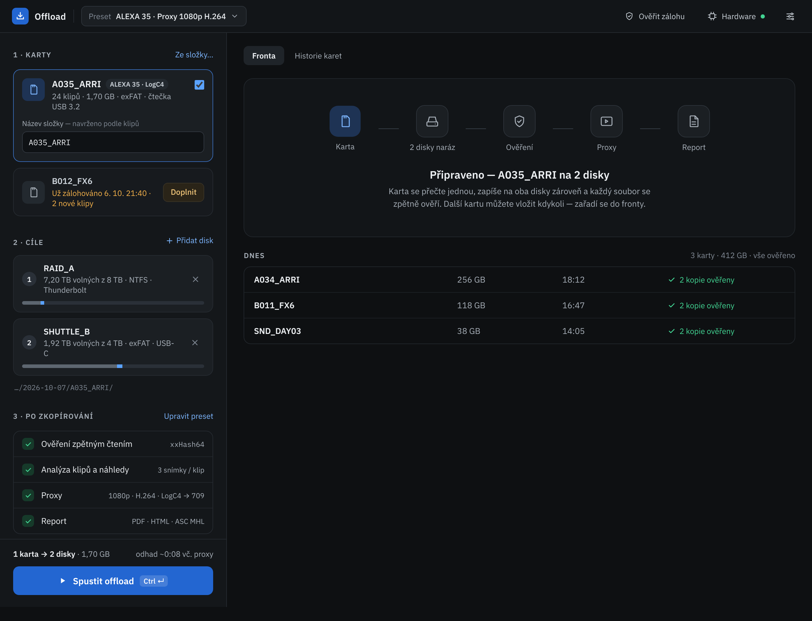
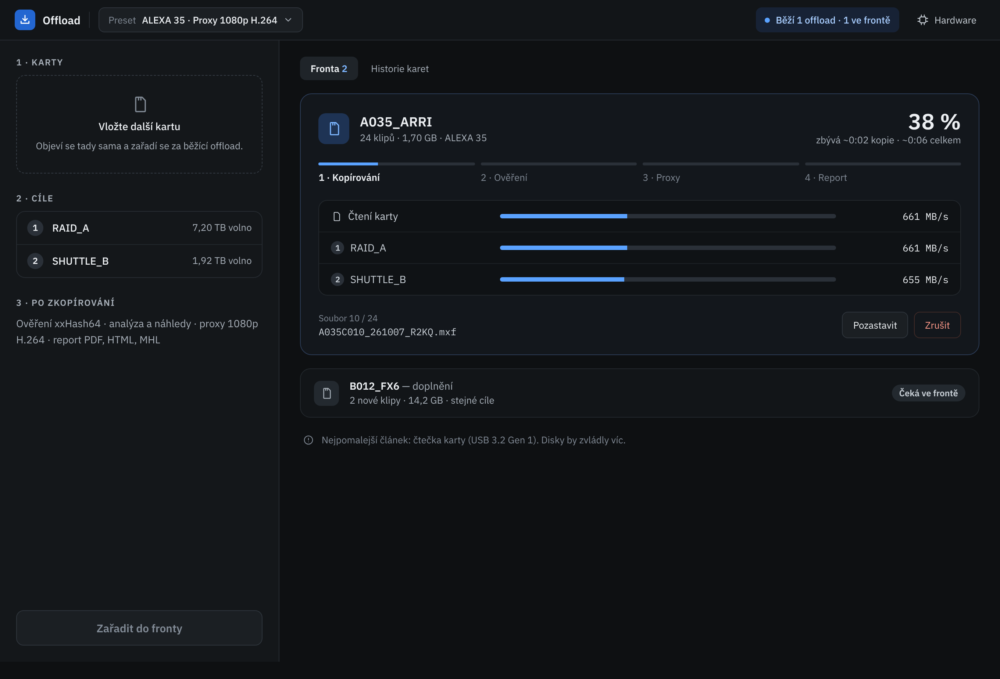
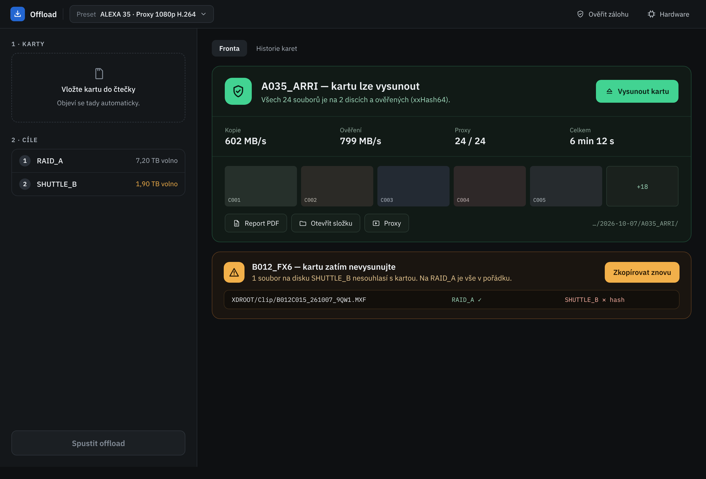
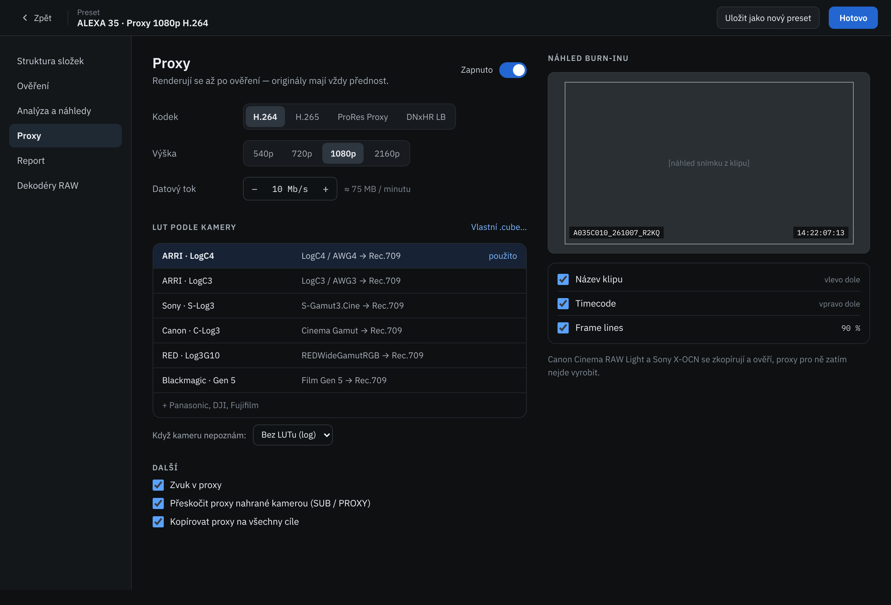

# Offload — nový vzhled UI (podklad pro implementaci)

*Návrh 2026-10-07. Schváleno: dvousloupcové rozvržení — obrazovky 1–4 níže.*

Tento dokument je zadání pro přestavbu GUI. Funkce aplikace se **nemění** — mění se rozvržení, vizuální styl
a pár drobností v tom, co UI ukazuje. Většina dat už v ViewModelech existuje (viz [Mapování na kód](#mapování-na-současný-kód)).
Co v kódu chybí, je vyjmenované v [Nové věci](#nové-věci-které-v-kódu-zatím-nejsou).

- `screeny/` — PNG obrazovek (2× rozlišení, okno 1360 px; `01-pripraveno-uzke.png` = okno 1000 px)
- `mockup/` — HTML zdroj obrazovek. **Přesné barvy, rozměry a texty ber odsud** (inline styly), screenshot je jen náhled.

## Zadání pro vývojového Clauda

> Přestav GUI Windows verze (`windows/src/Offload.App`, WPF) podle `docs/ui-navrh/`. Postupuj po fázích
> v sekci [Postup](#postup-implementace), po každé fázi build + `dotnet test` a krátký zápis do `docs/VYVOJ-WINDOWS.md`.
> Logiku a ViewModely měň jen tam, kde to dokument výslovně říká; nové vlastnosti přidávej do VM, ne do code-behind.
> Mac verzi (SwiftUI) zatím neměň — až po schválení Windows verze, a pak zapiš rozdíly do `docs/ROZDILY.md`.
> Než začneš s „Novými věcmi“ (presety, pauza…), zeptej se — ne všechny jsou schválené.

---

## Obrazovky

| # | Soubor | Stav |
|---|---|---|
| 1 | `screeny/01-pripraveno.png` | Karta vložená, cíle vybrané, připraveno ke spuštění. Fronta prázdná, dole dnešní historie. |
| 2 | `screeny/02-probiha-offload.png` | Běží kopie; další karta čeká ve frontě. Levý sloupec se zjednoduší. |
| 3 | `screeny/03-hotovo-a-chyba.png` | Jedna karta hotová a ověřená (zelená), druhá s nesouhlasným souborem (žlutá). |
| 4 | `screeny/04-nastaveni-proxy.png` | Nastavení (preset) — sekce Proxy. Dosavadní dlouhý seznam voleb z levého panelu se přesouvá sem. |

## Hlavní principy

1. **Tři očíslované kroky vlevo**: `1 · Karty` → `2 · Cíle` → `3 · Po zkopírování`. Uživatel čte shora dolů a dole mačká Spustit.
2. **Nastavení je schované.** Krok 3 ukazuje jen 4řádkové shrnutí (Ověření, Analýza, Proxy, Report) s odkazem *Upravit preset*.
   Všechny volby (struktura složek, ověření, proxy, LUT, burn-in, dekodéry) jsou v samostatné obrazovce Nastavení (obr. 4).
3. **Stav musí jít přečíst z dálky.** Velké procento, zelená = lze vysunout, žlutá = nevysunovat, červená jen pro skutečnou chybu.
   Barvy stavů se liší i světlostí (ne jen odstínem).
4. **Tmavé téma**, monospace pro cesty, názvy souborů, hashe a rychlosti.
5. **Tlačítko Spustit je vždy vidět** — spodní lišta levého sloupce je připnutá, obsah nad ní roluje samostatně.

## Design tokeny

Definuj jako zdroje na jednom místě (WPF: `Themes/Offload.xaml` sloučený v `App.xaml`; SwiftUI: `Theme.swift`).

### Barvy

| Token | Hex | Použití |
|---|---|---|
| `Bg` | `#0E1012` | pozadí okna, pravý sloupec |
| `BgHeader` | `#121518` | horní lišta, prázdné/sekundární karty ve frontě |
| `Panel` | `#14171A` | levý sloupec, panely |
| `Raised` | `#1B1F23` | dlaždice (karta, disk), tlačítka sekundární |
| `RaisedAlt` | `#171A1E` | nevybraná karta |
| `Input` | `#0F1215` | textová pole, tabulka rychlostí |
| `Line` | `#262B31` | okraje panelů a dlaždic |
| `LineSoft` | `#22272C` | oddělovače řádků |
| `LineStrong` | `#2E343B` / `#323840` | okraje tlačítek / inputů |
| `Track` | `#2A3038` | podklad progress barů, kolečka s číslem disku |
| `Text` | `#ECEFF2` | primární text |
| `Text2` | `#A7AFB8` | sekundární text, popisky |
| `Text3` | `#808994` | nejslabší text (cesty, nápovědy) — min. kontrast 4,5:1 na `Panel` |
| `Accent` | `#2366D1` | primární tlačítko (bílý text), logo |
| `AccentText` | `#7DB6FF` | odkazy, ikony na modrém pozadí |
| `AccentBar` | `#5AA2FF` | progress, checkboxy, „potřebné místo“ v pruhu disku |
| `AccentSoft` | `#1E3354` / `#172235` | pozadí ikony karty / vybrané řádky, pill „Běží“ |
| `AccentBorder` | `#3A6FBF` | okraj vybrané karty |
| `Success` | `#42D392` | hotovo, ověřeno (text na tmavém; jako výplň s textem `#0B1F15`) |
| `SuccessBg` / `SuccessBorder` | `#111A16` / `#1F4A36` | karta „hotovo“ |
| `SuccessText2` | `#9FD9BC` | popis pod nadpisem hotovo |
| `Warn` | `#F2B04A` | už zálohováno, nesouhlasí soubor, málo místa (výplň s textem `#2A1A05`) |
| `WarnBg` / `WarnBorder` | `#1A1510` / `#5A3A1E` | karta s varováním |
| `WarnText2` | `#E8C891` | popis varování |
| `Danger` | `#FF7D6B` (text `#FF9A8A`) | Zrušit, selhání ověření („✕ hash“: `#FFB4A6`) |
| `DiskUsed` | `#5D6670` | obsazené místo v pruhu disku |

### Typografie

- Návrh: **IBM Plex Sans** (UI) + **IBM Plex Mono** (cesty, soubory, rychlosti, hashe, timecode). Licence OFL — lze přibalit jako
  resource. Přijatelná náhrada: Windows `Segoe UI Variable` + `Cascadia Mono`, Mac systémový `SF Pro` + `SF Mono`.
- Velikosti: základ 14, popisky 13, drobné 12; nadpisy sekcí 12 / SemiBold / VERSALKY / prostrkání 0,08 em / `Text2`;
  název karty 15–18 SemiBold; nadpis hotovo 20 SemiBold; procento průběhu 30 SemiBold s tabulkovými číslicemi.

### Rozměry

- Zaoblení: dlaždice 12, hlavní karty ve frontě 16, tlačítka 8, primární tlačítko 10, pilulky 99.
- Odsazení: levý sloupec 22, pravý 22/28; mezera mezi sekcemi 26, mezi dlaždicemi 10.
- Klikací plochy min. 32 px výšky (tlačítka v liště 34, primární 48).
- Levý sloupec 380–460 px (dnes `400`, min 360, max 480 — zachovat GridSplitter). Okno min 940×640 zůstává.

## Rozvržení a komponenty

### Horní lišta (všechny obrazovky)

Logo (28 px čtverec `Accent` s ikonou) + „Offload“ · oddělovač · **přepínač presetu** (`Preset  ALEXA 35 · Proxy 1080p H.264 ▾`) ·
volné místo · `Ověřit zálohu` (Ctrl+Shift+O) · `Hardware` se stavovou tečkou (zelená = porty OK, žlutá = doporučení) ·
ikona Nastavení. Nahrazuje dnešní menu „Nástroje“ (položky z menu se přesunou sem a do Nastavení).
Když něco běží, vlevo od tlačítek je pilulka `● Běží 1 offload · 1 ve frontě`.

### Levý sloupec — nový offload (obr. 1)

**1 · Karty** (vpravo odkaz *Ze složky…* = `AddSourceCommand`)

- *Vybraná karta* — okraj `AccentBorder`; ikona, název, štítek kamery (`ALEXA 35 · LogC4`), řádek `24 klipů · 1,70 GB · exFAT · čtečka USB 3.2`,
  checkbox vpravo nahoře, pod tím pole **Název složky** s nápovědou „— navrženo podle klipů“ (`NameHint`).
- *Už zálohovaná karta* — šedá ikona, žlutý text `Už zálohováno 6. 10. 21:40 · 2 nové klipy` (`HistoryText`, `HistoryTone`)
  a žluté tlačítko **Doplnit** (`AppendNewFiles`).
- *Prázdný stav* — přerušovaný rámeček „Vložte kartu do čtečky — objeví se tady automaticky.“

**2 · Cíle** (vpravo *+ Přidat disk*)

- Dlaždice disku: kolečko s pořadím, název, `7,20 TB volných z 8 TB · NTFS · Thunderbolt`, ✕ odebrat.
- **Pruh místa**: šedá = obsazeno, modrá = kolik zabere tahle karta (vč. proxy a reportu z kontroly místa). Při `SpaceWarning` žlutý, při `SpaceProblem` červený a text pod pruhem.
- Pod dlaždicemi náhled cesty v monospace: `…/2026-10-07/A035_ARRI/` (`PathPreview`).
- Jen jeden cíl → žlutá hláška „Jen jeden cíl — doporučeny jsou dvě nezávislé kopie.“ (`SingleDestination`).

**3 · Po zkopírování** (vpravo *Upravit preset* → obrazovka Nastavení)

4 řádky se zeleným odškrtnutím a hodnotou vpravo: Ověření zpětným čtením `xxHash64` · Analýza klipů a náhledy `3 snímky / klip` ·
Proxy `1080p · H.264 · LogC4 → 709` · Report `PDF · HTML · ASC MHL`. Vypnutá položka = šedý kroužek + „vypnuto“.
Vypnuté ověření → řádek žlutý („Bez ověření není jisté, že data na disku jsou v pořádku.“).

**Spodní lišta (připnutá)**: souhrn `1 karta → 2 disky · 1,70 GB` + odhad vpravo, pod tím primární tlačítko
`▶ Spustit offload  [Ctrl ↵]` (`StartCommand`). `StartProblem` se zobrazí nad tlačítkem a tlačítko je neaktivní.

### Levý sloupec během kopírování (obr. 2, 3)

Bez vložené karty se krok 1 zmenší na prázdný stav, krok 2 na kompaktní seznam (název + volné místo), krok 3 na jeden řádek textu.
Tlačítko je neaktivní („Zařadit do fronty“ / „Spustit offload“). Jakmile se vloží karta, vrátí se plná podoba z obr. 1.

### Pravý sloupec — fronta

Záložky `Fronta` / `Historie karet` nahoře.

- **Prázdná fronta** (obr. 1): karta s pěti ikonami propojenými čarou (Karta → 2 disky naráz → Ověření → Proxy → Report),
  pod tím „Připraveno — A035_ARRI na 2 disky“ + jedna věta vysvětlení. Bez vybrané karty: „Zatím žádný offload“.
- **Dnes**: tabulka dnešních karet (název, velikost, čas, `✓ 2 kopie ověřeny`) a souhrn `3 karty · 412 GB · vše ověřeno`.

#### Karta úlohy — běží (obr. 2)

- Hlavička: ikona karty, název, `24 klipů · 1,70 GB · ALEXA 35`; vpravo velké `38 %` a `zbývá ~0:02 kopie · ~0:06 celkem`.
- **Ukazatel fází** — 4 segmenty: Kopírování · Ověření · Proxy · Report. Hotové segmenty plné, aktivní podle průběhu, další šedé.
  Mapování z `JobPhase`: `Copying` + `Flushing` → 1; `Verifying` → 2; `Analyzing` + `Proxies` → 3; `Reporting` → 4.
  Vypnuté fáze (bez proxy…) se nezobrazují.
- **Tabulka rychlostí** (pozadí `Input`): řádek *Čtení karty* + řádek pro každý cíl — název, progress bar, rychlost v monospace.
  Zdroj: `ChainLines` / `HasChain` (dnes text) → potřeba strukturovaná data, viz Nové věci.
- Pod tabulkou: `Soubor 10 / 24` + aktuální soubor v monospace; vpravo `Zrušit` (`CancelCommand`, červený obrys).
- Pod kartou šedá informační řádka „Nejpomalejší článek: čtečka karty (USB 3.2 Gen 1).“ — z `progress.Brake`.

#### Karta úlohy — čeká

Kompaktní řádek: ikona, název (+ „— doplnění“ u append), `2 nové klipy · 14,2 GB · stejné cíle`, pilulka `Čeká ve frontě`.

#### Karta úlohy — hotovo (obr. 3, zelená)

- Hlavička: zelený štít 52 px, **„A035_ARRI — kartu lze vysunout“**, pod tím `SafeText`; vpravo zelené tlačítko **Vysunout kartu** (`EjectCommand`).
- Řádek 4 čísel: Kopie (MB/s) · Ověření (MB/s) · Proxy (x / y) · Celkem (čas) — dnes `SummaryText` jako jeden řetězec.
- Náhledy prvních 5 klipů (16:9, název klipu vlevo dole) + dlaždice „+18“.
- Tlačítka: Report PDF (`OpenReportCommand`), Otevřít složku (`RevealCommand`), Proxy; vpravo cesta v monospace.

#### Karta úlohy — nesouhlasí / chyba (obr. 3, žlutá)

- Žlutý trojúhelník, **„B012_FX6 — kartu zatím nevysunujte“**, popis „1 soubor na disku SHUTTLE_B nesouhlasí s kartou. Na RAID_A je vše v pořádku.“
- Tlačítko **Zkopírovat znovu** (žlutá výplň).
- Seznam problémových souborů: cesta · stav na každém cíli (`RAID_A ✓`, `SHUTTLE_B ✕ hash`).
- Tvrdá chyba (`ErrorText`, celá úloha selhala) = stejná karta v červené (`Danger`).
- Zrušeno (`CancelledText`) = šedá karta.

### Nastavení presetu (obr. 4)

Celé okno (nebo stránka místo hlavního obsahu): lišta `‹ Zpět` · název presetu · `Uložit jako nový preset` · `Hotovo`.
Vlevo navigace sekcí: Struktura složek · Ověření · Analýza a náhledy · **Proxy** · Report · Dekodéry RAW.

Sekce Proxy:
- Přepínač Zapnuto (`Proxy.Enabled`).
- Kodek a Výška jako segmentové přepínače (`Codecs`/`Codec`, `Heights`/`Height`); Datový tok jako stepper `− 10 Mb/s +` s odhadem MB/min.
- **LUT podle kamery** — tabulka vestavěných LUTů (z `shared/luts/luts.json`), použitý zvýrazněný; *Vlastní .cube…* (`PickLutCommand`);
  „Když kameru nepoznám:“ (`FallbackChoices`/`Fallback`).
- Další: Zvuk, Přeskočit proxy nahrané kamerou, Kopírovat proxy na všechny cíle, (+ složka pro proxy navíc).
- Vpravo **náhled burn-inu**: 16:9 rám s frame lines (90 % = `ScaleText`), název klipu vlevo dole, TC vpravo dole; pod tím přepínače
  Název klipu / Timecode / Frame lines s hodnotou.
- Poznámka „Canon Cinema RAW Light a Sony X-OCN se zkopírují a ověří, proxy pro ně zatím nejde vyrobit.“

Ostatní sekce postav ze stávajících ovládacích prvků `SetupPanel.xaml` ve stejném stylu (popisek vlevo 120 px, ovládání vpravo).

## Mapování na současný kód

Windows: `SetupPanel.xaml` (levý sloupec), `QueuePanel.xaml` (fronta), `MainWindow.xaml` (lišta/menu).
Mac: `mac/Sources/OffloadApp/Views.swift` (`SetupPanel`, `SourcesSection`, `DestinationsSection`, `ProxySection`, `StartBar`, `QueuePanel`, `JobCard`).

| Prvek návrhu | Existující binding (WPF) |
|---|---|
| Seznam karet, checkbox | `Sources`, `IsSelected`, `Title`, `Detail`, `Glyph` |
| Název složky + nápověda | `CardName`, `CardNamePlaceholder`, `NameHint`, `SuggestCardNames` |
| Už zálohováno / Doplnit | `HistoryText`, `HistoryTone`, `AppendNewFiles`, `AppendText` |
| Ze složky… / obnovit | `AddSourceCommand`, `RefreshVolumesCommand` |
| Cíle | `Destinations` (`Index`, `Name`, `FreeText`, `FsWarning`, `RemoveCommand`), `AddDestinationCommand`, `HasNoDestinations`, `SingleDestination` |
| Pruh místa a hlášky | `SpaceWarning`, `SpaceProblem` (+ data z `MainViewModel.Space.cs`) |
| Náhled cesty | `PathPreview`, `UseCustomDate`, `CustomDate` |
| Shrnutí kroku 3 | `Verify`, `AnalyzeClips`, `Proxy.*` |
| Spodní lišta | `CardsText`, `DestinationsText`, `StartCommand`, `StartProblem`, `StartStatus` |
| Hardware v liště | `OpenHardwareCommand`, `HardwareSummary` |
| Ověřit zálohu | `VerifyBackupCommand`, `SaveVerifyReport` |
| Fronta | `Jobs`, `HasJobs`, `ClearFinishedCommand` |
| Karta úlohy | `Title`, `Sub`, `FilesText`, `DestinationLines`, `Progress`, `StatusText`, `Tone`, `DetailText`, `ChainLines`, `HasChain`, `IsRunning`, `CanCancel`, `CancelCommand` |
| Hotovo | `ShowSafe`, `SafeText`, `ShowEjectButton`, `EjectCommand`, `Ejected`, `SummaryText`, `HasReport`, `OpenReportCommand`, `RevealCommand`, `ReportNote` |
| Chyby/varování | `ResultText`, `ResultTone`, `FailedText`, `ErrorText`, `WarningText`, `Warnings`, `NoteText`, `CancelledText` |
| Proxy nastavení | `Proxy.Enabled`, `Codecs`, `Codec`, `Heights`, `Height`, `BitrateText`, `BitrateUp/DownCommand`, `LutChoices`, `LutChoice`, `PickLutCommand`, `FallbackChoices`, `Fallback`, `BurnFilename`, `BurnTimecode`, `ScaleText`, `Scale*Command`, `Audio`, `SkipCameraProxies`, `CopyToAllDestinations`, `ExtraFolder*` |
| Dekodéry | `Tools`, `ToolsWarning` |

## Nové věci, které v kódu zatím nejsou

Seřazeno od nejdůležitějšího. **Před implementací 5–9 se zeptej.**

1. **Strukturovaný průběh na cíl** — dnes `ChainLines` vrací text. Pro tabulku rychlostí potřebujeme seznam
   `{ Název, Podíl 0–1, MB/s }` pro kartu a každý cíl (data jsou v `JobProgress` / `ChainView`).
2. **Ukazatel fází** — odvodit z `Phase` a z nastavení úlohy (které fáze běží) → `IReadOnlyList<PhaseStep>` ve `JobItemViewModel`.
3. **Souhrn hotové úlohy po polích** — místo jednoho `SummaryText` čtyři hodnoty (kopie MB/s, ověření MB/s, proxy x/y, celkový čas).
4. **Seznam nesouhlasných souborů po cílech** — z `Report.FailedFiles`; plus akce **Zkopírovat znovu** (nová úloha jen pro chybné soubory, nebo celé karty — rozhodnout).
5. **Presety** — pojmenované sady nastavení (struktura, ověření, analýza, proxy, report), přepínač v liště, „Uložit jako nový preset“. Úložiště vedle `history.json`. *Neschváleno.*
6. **Štítek kamery a typ připojení** (`ALEXA 35 · LogC4`, `Thunderbolt`, `čtečka USB 3.2`) — z rychlé analýzy karty a z HW diagnostiky.
7. **Dnešní historie v pravém sloupci** — z `history.json`.
8. **Náhled burn-inu** se skutečným snímkem (zatím stačí šedý rám).
9. **Pozastavit** úlohu — v návrhu je jen *Zrušit*; pauza v jádru neexistuje, nedělat bez dohody.
10. **Odhad celkového času vč. proxy** na spodní liště — pokud nejde spolehlivě, zobrazit jen velikost.

## Postup implementace

1. **Téma** — tokeny jako `ResourceDictionary` (barvy, štětce, styly: `SectionTitle`, `Caption`, `Tile`, `PrimaryButton`, `GhostButton`, `Pill`, `ProgressThin`).
   Aplikace dnes používá `ThemeMode="System"` (Fluent) — přepnout na vynuceně tmavé a Fluent styly přepsat vlastními, kde se liší.
2. **Horní lišta** v `MainWindow.xaml` místo menu Nástroje (zachovat klávesové zkratky Ctrl+Enter, Ctrl+U, Ctrl+Shift+O).
3. **Levý sloupec** — přestavět `SetupPanel.xaml` na kroky 1–3 + připnutou spodní lištu (`DockPanel`: lišta `Dock=Bottom`, obsah v `ScrollViewer`).
   Volby, které nejsou ve shrnutí, přesunout do okna Nastavení (krok 6).
4. **Fronta** — `QueuePanel.xaml`: prázdný stav, karty úloh ve stavech běží / čeká / hotovo / varování / chyba / zrušeno. Nejdřív se stávajícími daty, pak body 1–4 z Nových věcí.
5. **Historie dnes** pod frontou.
6. **Okno Nastavení** (`SettingsWindow.xaml`) s navigací sekcí; sekce Proxy podle obr. 4, ostatní ze stávajících prvků.
7. Ruční kontrola: okno 1360×900 a 940×640, karta vložená/žádná, 1 cíl, málo místa, běh, hotovo, zrušení, chyba ověření (lze vyvolat testem s poškozeným souborem).
8. Zápis do `docs/VYVOJ-WINDOWS.md`; rozdíl proti Macu do `docs/ROZDILY.md`.

## Otevřené otázky

- Jen tmavé téma, nebo i světlé (tokeny jsou připravené na dvě sady)?
- Presety ano/ne a kde je ukládat.
- „Zkopírovat znovu“: jen chybné soubory, nebo celou kartu na postižený disk?
- Přibalit IBM Plex, nebo systémová písma?
